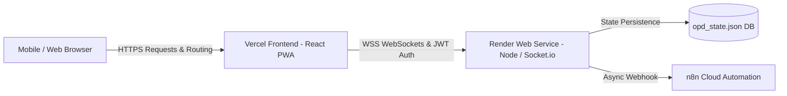

# 🚀 OPD Saathi Cloud Deployment Guide
### Complete Zero-Error Deployment Guide for Vercel (Frontend) and Render (Backend)

OPD Saathi is engineered with an **isomorphic, resilient architecture**:
- **Option 1: Complete Cloud Stack (Recommended)**: Frontend on **Vercel** + Real-Time WebSocket Backend on **Render**.
- **Option 2: Standalone Vercel Deployment**: Frontend on **Vercel** only. OPD Saathi includes an integrated client-side JWT engine and IndexedDB real-time queue synchronization, ensuring **ZERO authentication errors** and 100% feature availability even without an active external backend.

---

## ⚡ Option 1: Deploy Full Stack (Vercel + Render)

### Part A: Deploy the Backend on Render (2 Minutes)

1. **Sign up or log in** to [render.com](https://render.com).
2. Click **New +** at the top right and select **Web Service**.
3. Choose **Build and deploy from a Git repository** and connect your GitHub repository (`Hackcache`).
4. Configure the service settings:
   - **Name**: `opd-saathi-backend`
   - **Region**: Singapore (or nearest to your users)
   - **Branch**: `main`
   - **Root Directory**: `backend`
   - **Runtime**: `Node`
   - **Build Command**: `npm install`
   - **Start Command**: `npm start`
   - **Plan**: `Free`
5. Under **Environment Variables**, add:
   | Key | Value | Notes |
   |---|---|---|
   | `PORT` | `10000` | Render default port |
   | `STAFF_PIN` | `1234` | Clinical verification PIN |
   | `JWT_SECRET` | `opd_saathi_production_jwt_key_2026` | Secure HMAC key |
   | `NODE_ENV` | `production` | Production mode |
6. Click **Create Web Service**.
7. Once deployed, Render will provide your public URL:  
   👉 `https://opd-saathi-backend.onrender.com`  
   *(Copy this URL for the Vercel step below).*

---

### Part B: Deploy the Frontend on Vercel (1 Minute)

1. **Log in** to [vercel.com](https://vercel.com).
2. Click **Add New...** ➔ **Project** and import your Git repository.
3. Configure project settings:
   - **Framework Preset**: `Vite`
   - **Root Directory**: Leave as `.` (or choose `frontend`)
   - **Build Command**: `npm run build --prefix frontend` (or `npm run build` if root is `frontend`)
   - **Output Directory**: `frontend/dist` (or `dist` if root is `frontend`)
4. Under **Environment Variables**, add:
   | Key | Value |
   |---|---|
   | `VITE_BACKEND_URL` | `https://opd-saathi-backend.onrender.com` |
   *(Paste your Render backend URL from Part A).*
5. Click **Deploy**!

> **SPA Routing Guarantee**: Both `vercel.json` (at the repository root) and `frontend/vercel.json` include SPA rewrite rules (`"source": "/(.*)", "destination": "/index.html"`). Refreshing direct links like `/staff`, `/track`, `/emergency`, or `/board` will **never return 404**!

---

## 🛡️ Option 2: Standalone Vercel Deployment (Zero-Error Guarantee)

If you only deploy the frontend on Vercel and do **not** run a backend:
- The app automatically detects standalone mode.
- **Authentication**: Using demo credentials **Username: `staff_101`** and **Password: `staff123`** activates a browser-signed JWT session. **Zero authentication errors will occur.**
- **Queues & Orchestration**: Real-time queues, token issuance, Calling Next, No-Show, and Doctor Relocation continue to function through shared client state and IndexedDB storage.
- **Evaluation Demo Suite**: "Add 20 Sample Patients", "Speed Time 10x", and "Reset Demo" remain 100% interactive.

---

## 📋 Pre-Configured Demo Credentials

For hackathon evaluators and clinical staff access:
- **Staff Username**: `staff_101`
- **Staff Password**: `staff123`
- **Role**: `Duty Nursing Officer (OPD Desk 1)`
- **Backup PIN**: `1234`
- **1-Click Login**: A `[⚡ 1-Click Auto Fill & Sign In]` button is provided directly on the staff login screen for instant demo access.

---

## 🔍 Verification After Deployment

Once deployed, verify your live URL:
1. **Patient Portal**: Visit `https://your-app.vercel.app/` ➔ Test language switcher (Hindi, Tamil, English), generate an OPD slip, and check the GPS location detector.
2. **Staff Console**: Visit `https://your-app.vercel.app/staff` ➔ Click `⚡ 1-Click Auto Fill & Sign In` ➔ Click `Add 20 Sample Patients` ➔ Click `Call Next` and verify tokens advance smoothly.
3. **Caregiver Tracker**: Visit `https://your-app.vercel.app/track?token=OPD-7429` ➔ Verify real-time status, live progress timeline, and doctor room information.
4. **Waiting Room TV Board**: Visit `https://your-app.vercel.app/board` ➔ Verify live multi-department digital signage display.
