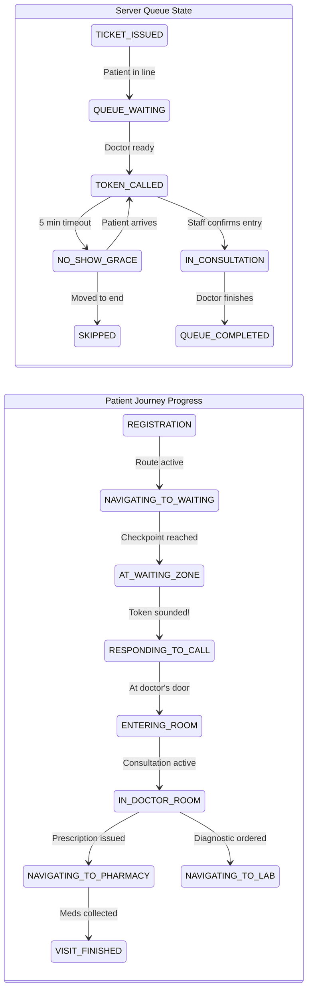
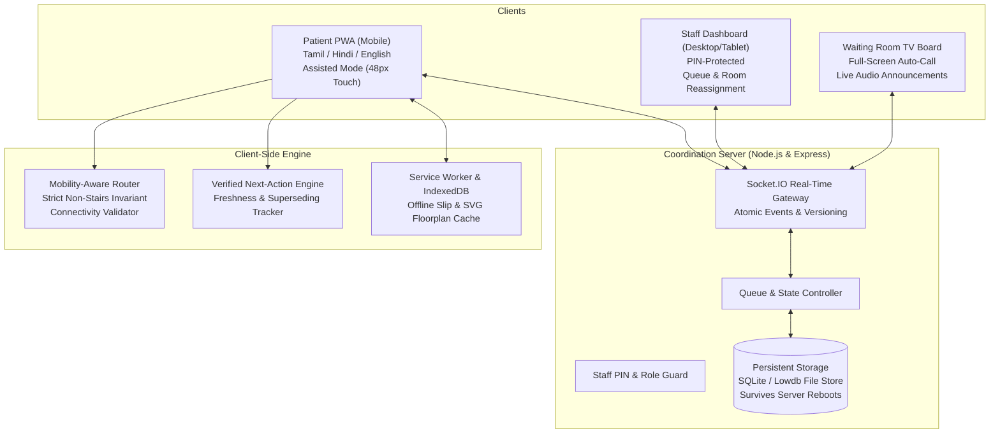

# OPD Saathi: Adaptive Hospital Journey Companion
## Hackathon Architectural Specification & Judging Strategy Blueprint (v2.0)

---

## 1. Executive Summary & Core Positioning

### 1.1 The Problem: The "Post-Slip" Black Hole in Government Hospitals
In high-density public healthcare facilities, acquiring an OPD slip is only the start of an overwhelming journey. Patients—predominantly elderly, rural, low-literacy, or non-English-speaking individuals—face:
- **Physical disorientation**: Incomprehensible signage, fragmented building layouts, and non-functional vertical transit (broken elevators/stair-only routes).
- **Operational volatility**: Doctors swapping consultation rooms mid-shift, unexpected lunch breaks, emergency relocations, and unannounced queue pauses.
- **Cognitive overload**: Anxiety from missing called tokens while searching for labs or pharmacies.
- **Connectivity dropouts**: Thick concrete hospital corridors creating dead zones where web-based queue displays freeze without alerting the user.

### 1.2 Primary Persona: Kamla (62, Solo OPD Visitor)
- **Profile**: 62-year-old grandmother visiting a 3-floor district hospital alone.
- **Language Profile**: Primary and preferred language is **Tamil (தமிழ்)** for all interface prompts, navigation audio, and token announcements, with full parity in **Hindi (हिंदी)** and **English**.
- **Mobility Constraints**: Walks slowly with arthritic knees; **strictly cannot climb stairs under any circumstances**.
- **Literacy & Digital Familiarity**: Limited reading ability; relies heavily on high-contrast iconography, spoken audio prompts, recognizable color-coded physical landmarks, and large tap targets (minimum 48px).
- **The Core Mandate**: Kamla does not need another complex dashboard. She needs a calm, trustworthy companion that continuously and verifiably answers three fundamental questions:
  1. **Where am I right now?**
  2. **What is my single next physical and clinical action?**
  3. **What do I do if something changes or I get lost?**

### 1.3 Strategic Positioning
> **"OPD Saathi: An Adaptive Hospital Journey Companion that guides, adapts, and recovers when the hospital visit doesn't go as planned."**

---

## 2. Competitive Differentiation Matrix: Baseline vs. Winning Innovations

| Dimension | Standard Hackathon Submission | OPD Saathi (Our Approach) | Judging Impact |
| :--- | :--- | :--- | :--- |
| **Queue vs. Journey State** | Conflates token numbers with clinical progress. Once a token is called, assumes patient is inside. | **Decoupled Architecture (§3.1)**: Strictly separates server-owned queue states (`WAITING`, `CALLED`, `IN_CONSULTATION`) from physical patient milestones (`ARRIVING`, `DOORSTEP`, `IN_ROOM`). | Prevents incorrect workflow transitions and audit mismatches. |
| **Navigation & Safety** | Shortest-path Dijkstra that uses stairs or blindly fails when a lift is down. | **Strict Mobility Router (§4.2)**: Explicitly filters stairs. If a lift is closed and no ramp exists, refuses to route up stairs and triggers staff handoff. | Demonstrates genuine patient safety and non-negotiable accessibility. |
| **Room / Destination Changes** | Silent update or just changes a label on screen without contextual explanation. | **Verified Next-Action Engine (§3.2)**: Explains the room swap, supersedes stale instructions with timestamps, and generates new accessible directions in Tamil. | **The primary differentiator**: Solves the real reason patients get lost post-slip. |
| **Server Resilience** | Ephemeral in-memory state; server restart wipes all active hospital queues. | **Persistent Storage (§4.1)**: Lightweight file-backed persistent store (SQLite / Lowdb) ensuring active queues survive process reboots. | Shows production-grade software engineering rigor. |
| **Connectivity Dropouts** | Blank screens or spinners when walking into concrete basements. | **Confidence-Aware Offline PWA (§4.4)**: Full offline client cache of slip, graph, and landmark instructions; explicit "Pending Staff Confirmation" badges. | Reliable during judging even with weak venue Wi-Fi. |
| **Digital Failure / Confusion** | Chatbot dead-end or text-heavy help FAQ. | **Human Assistance Handoff (§5.2)**: One-tap SOS displaying a high-contrast bilingual card for physical security guards + helpdesk alert. | Acknowledges the limits of automation with practical human support. |

---

## 3. Journey State Machine & The Verified Next-Action Engine

### 3.1 Decoupling Queue Status from Physical Visit Progress
A token being called on a display board does **not** mean the patient is inside the doctor's room. OPD Saathi maintains two distinct, synchronized state machines:



### 3.2 The Signature Feature: Verified Next-Action State Engine
For every step of the journey, the client maintains a verifiable, deterministic state object that eliminates ambiguity when hospital conditions change:

```typescript
interface VerifiedNextActionState {
  currentStepId: string;
  stepPhase: 
    | 'REGISTRATION' 
    | 'NAVIGATING_TO_WAITING' 
    | 'AT_WAITING_ZONE' 
    | 'RESPONDING_TO_CALL' 
    | 'IN_CONSULTATION' 
    | 'NAVIGATING_TO_LAB' 
    | 'NAVIGATING_TO_PHARMACY' 
    | 'VISIT_FINISHED';
  
  // Destination Tracking
  intendedDestination: {
    roomId: string;
    roomName: string;
    floor: number;
    department: string;
  };
  lastConfirmedDestination: {
    roomId: string;
    roomName: string;
    floor: number;
    confirmedAt: string; // ISO 8601 Timestamp
    confirmedBy: string; // e.g., "Reception-Desk-1" | "Dr-Verma-Staff"
  };

  // Freshness & Validity Tracking
  instructionFreshness: 'CURRENT' | 'STALE' | 'SUPERSEDED' | 'DISRUPTED';
  supersededInstructionNote?: {
    previousRoom: string;
    reason: string;
    localizedExplanation: { en: string; hi: string; ta: string };
  };

  // Next Expected Action from the Patient
  nextExpectedAction: {
    actionCode: string;
    localizedText: { en: string; hi: string; ta: string };
    audioPromptKey: string;
    visualLandmarkCue: string;
  };

  // Safety & Staff Requirements
  staffConfirmationRequired: boolean;
  safeRecoveryOption: {
    fallbackAction: 'PROCEED_TO_HELPDESK' | 'WAIT_AT_CURRENT_ZONE' | 'REQUEST_ATTENDANT';
    helpdeskLocation: { floor: number; landmark: string };
    showPhysicalHelpCard: boolean;
  };
}
```

#### Example Scenario: Doctor Room Reassignment Workflow
1. **Trigger**: Staff reassigns Dr. Verma from Room 104 (Floor 1) to Room 208 (Floor 2).
2. **Server Broadcast**: Emits `ROOM_REASSIGNED` with `{ doctorId, oldRoom: '104', newRoom: '208', floor: 2, timestamp, version }`.
3. **Engine Evaluation**:
   - Compares `intendedDestination` with `lastConfirmedDestination`.
   - Sets `instructionFreshness = 'SUPERSEDED'`.
   - Records: `previousRoom = '104'`, `newRoom = '208'`.
   - Synthesizes clear Tamil notification:
     > *"முந்தைய அறிவிப்பு மாற்றப்பட்டுள்ளது. டாக்டர் வர்மா அறை 104-ல் இருந்து தளம் 2-ல் உள்ள அறை 208-க்கு மாற்றப்பட்டுள்ளார். லிஃப்ட் ஏ வழியாக புதிய பாதை கணக்கிடப்பட்டுள்ளது."*
     > *(Previous instruction superseded. Dr. Verma has shifted from Room 104 to Room 208 on Floor 2. New route calculated via Lift A).*
   - Sets `nextExpectedAction`: "Take Lift A to Floor 2, walk past the Water Cooler to Room 208".
   - Verifies route feasibility under mobility constraints before rendering.

---

## 4. Technical Architecture, Routing & Resilience



### 4.1 Persistent Storage Guarantee
To ensure active queues and issued tokens are never lost during server restarts, network interruptions, or laptop battery swaps during hackathon judging:
- The server writes all queue states, patient tokens, and doctor assignments atomically to a **persistent disk-backed store (SQLite via `better-sqlite3` or atomic JSON database)**.
- On startup, the server reloads the authoritative queue sequence and verifies client reconnection tokens against the persistent store.

### 4.2 Mobility-Aware Routing Engine & The Strict Safety Invariant
The hospital is represented as a directional, weighted graph with explicit node and edge attributes:
```json
{
  "nodes": [
    { "id": "ENTRANCE_G", "floor": 0, "name": "Main Entrance", "type": "checkpoint", "landmark": "Main Security Gate" },
    { "id": "REG_COUNTER", "floor": 0, "name": "Registration Desk", "type": "counter", "landmark": "Opposite 'May I Help You' Counter" },
    { "id": "LIFT_A_F0", "floor": 0, "name": "Elevator Block A", "type": "lift", "status": "OPERATIONAL" },
    { "id": "LIFT_A_F1", "floor": 1, "name": "Elevator Block A - F1", "type": "lift", "status": "OPERATIONAL" },
    { "id": "RAMP_F0_F1", "floor": 0, "name": "Gentle Ramp to F1", "type": "ramp", "status": "OPERATIONAL" },
    { "id": "STAIRS_A_F0", "floor": 0, "name": "Staircase A", "type": "stairs", "status": "OPERATIONAL" },
    { "id": "OPD_104", "floor": 1, "name": "Orthopedics Room 104", "type": "doctor_room", "landmark": "Beside Drinking Water Station" },
    { "id": "OPD_208", "floor": 2, "name": "General Medicine Room 208", "type": "doctor_room", "landmark": "Opposite Immunization Wing" }
  ],
  "edges": [
    { "from": "ENTRANCE_G", "to": "REG_COUNTER", "distance": 15, "type": "corridor", "accessible": true },
    { "from": "REG_COUNTER", "to": "LIFT_A_F0", "distance": 20, "type": "corridor", "accessible": true },
    { "from": "REG_COUNTER", "to": "RAMP_F0_F1", "distance": 35, "type": "ramp", "accessible": true },
    { "from": "REG_COUNTER", "to": "STAIRS_A_F0", "distance": 10, "type": "stairs", "accessible": false },
    { "from": "LIFT_A_F0", "to": "LIFT_A_F1", "distance": 5, "type": "lift", "accessible": true }
  ]
}
```

#### Routing Constraints & Safety Rules:
1. **Explicit Stair Filter**: When `patientPreferences.avoidStairs === true`, all edges with `type === 'stairs'` or `accessible === false` are completely stripped from the graph before running Dijkstra.
2. **Transit Availability Filter**:
   - If a lift or ramp node is flagged `status !== 'OPERATIONAL'` (e.g. lift out of service), all connected vertical edges are pruned.
3. **The Strict Zero-Stairs Invariant**:
   > **Safety Law**: The routing engine must **NEVER** silently fall back to stairs for an elderly/wheelchair patient if lifts or ramps are unavailable.
   > 
   > If the graph connectivity check shows no valid accessible path to the destination floor, the algorithm returns:
   > `{ status: 'NO_ACCESSIBLE_ROUTE_FOUND', reason: 'ELEVATOR_OUT_OF_SERVICE_AND_NO_RAMP' }`.
   > 
   > The UI immediately transitions to **Human Assistance Handoff**, directing the patient to the nearest ground-floor Help Desk and alerting staff that an attendant/wheelchair escort is required.

---

## 5. Scope Boundaries: Hackathon MVP vs. Deferred Roadmap

### 5.1 MVP Scope (Must deliver for judging)
- [x] **P0 & P4 Language-Inclusive Assisted Patient Flow**: Registration, digital OPD slip generation with QR code, queue tracking, and landmark-guided navigation in **Tamil**, **Hindi**, and **English**.
- [x] **Verified Next-Action Engine (§3.2)**: Track freshness (`CURRENT`, `STALE`, `SUPERSEDED`), last confirmed timestamp, next expected patient action, and clear superseding explanations.
- [x] **Strict Mobility-Aware Router (§4.2)**: Zero-stair invariant; automatic ramp fallback; safe human-handoff trigger when no accessible path exists.
- [x] **Persistent Real-Time Sync (§4.1)**: Socket.IO synchronization backed by SQLite/file storage across Patient Phone, Staff Dashboard, and TV Board.
- [x] **Confidence-Aware Offline PWA**: Cached application shell, SVG maps, and saved slips with explicit sync timestamps.
- [x] **Human Assistance Handoff**: 1-tap multilingual card (*"Patient Kamla needs guidance to Room 208"*) for hospital attendants.
- [x] **Emergency Bypass Button**: Unmissable emergency action directing critical patients to Casualty immediately without joining any queue.

### 5.2 Deferred / Out-of-Scope (To present honestly in submission)
- Direct integration with real hospital HMIS / ABDM (Ayushman Bharat Digital Mission) production APIs (mocked via standard JSON payload).
- Bluetooth Low Energy (BLE) / iBeacon centimeter positioning hardware (zero-cost QR checkpoints and landmark graphs chosen for instant scalability).
- Automated medical diagnosis or algorithmic clinical triage (strictly administrative and navigational).

---

## 6. Measurable Evaluation Targets, SLAs & Verification Protocols

Judges distinguish engineering evidence from unverified claims. The following concrete test procedures will be executed and recorded:

| Target Domain | Engineering Target / SLA | Verification Test Procedure |
| :--- | :--- | :--- |
| **Mobility Safety Invariant** | **0% Stair Traversal** under `avoidStairs: true` | Automated test running 100 randomized source/destination pairs with simulated elevator outages. Assert zero returned paths contain `type === 'stairs'`. |
| **Recovery Latency** | **< 300 ms** local event propagation | Measure timestamp delta from staff clicking "Reassign Room" to the arrival of the WebSocket payload and client re-render. |
| **Offline Slip Availability** | **0 ms** network dependency | Load app, generate slip, trigger browser offline mode, reload page. Verify slip and navigation instructions display instantly from cache. |
| **Accessibility Compliance** | **100% WCAG AAA Touch Targets** | Automated CSS viewport audit: all interactive elements have bounding boxes ≥ 48×48px and color contrast ratio ≥ 7:1; test at 360px viewport width. |
| **Language Parity** | **0 Missing Translation Keys** | Automated JSON dictionary assertion: 100% key-value parity across `en.json`, `hi.json`, and `ta.json` with zero English fallbacks in Tamil mode. |
| **Persistence Resilience** | **Zero Data Loss on Crash** | Issue 5 patient tokens, kill the Node.js server process (`SIGKILL`), restart the server, and verify all 5 tokens and queue states restore accurately. |

---

## 7. The 3-Minute Hackathon Demonstration Script

### Timing & Scene Breakdown
- **0:00 - 0:35 | The Hook: Kamla's Reality in Public Hospitals**
  - *Speaker*: "Judges, this is Kamla. She is 62, has severe knee arthritis, speaks only Tamil, and is visiting a 3-floor government hospital alone. She holds an OPD slip—but signs are unreadable, the doctor just shifted rooms, and elevators are crowded or broken. Most apps only show a token number. OPD Saathi gives Kamla an Adaptive Journey Companion."
- **0:35 - 1:15 | The Guided Journey (Tamil & Strict Accessibility)**
  - *Action*: Pick up Phone 1 (Patient). Select **Tamil**. Toggle **Assisted Mode** (large text, high contrast).
  - *Highlight*: Display the OPD slip. Tap "வழிகாட்டவும்" ("Take Me There"). Point out that the router selects Ramp 1 and Lift A, completely ignoring the shorter, steep staircase.
  - *Audio*: Phone speaks in Tamil: *"தயவுசெய்து லிஃப்ட் ஏ-க்கு செல்லவும். பச்சை நிற குடிநீர் தொட்டிக்கு அருகில் செல்லவும்"* ("Proceed to Lift A past the green drinking water booth").
- **1:15 - 2:05 | The Signature Moment: Verified Room Recovery**
  - *Action*: Focus on the Laptop (Staff Dashboard). Doctor Verma moves from Room 104 to Room 208 on Floor 2. Staff confirms reassignment.
  - *Highlight*: **Instantly, Phone 1 vibrates, rings a chime, and speaks in Tamil**:
    > *"முந்தைய தகவல் மாற்றப்பட்டுள்ளது. டாக்டர் வர்மா அறை 208-க்கு மாற்றப்பட்டுள்ளார். லிஃப்ட் ஏ வழியாக புதிய பாதை கணக்கிடப்பட்டுள்ளது."*
  - *Screen*: Point to the **Verified Next-Action Card**: It explicitly shows *"Room 104 (SUPERSEDED) → Room 208 (Confirmed at 10:24 AM)"*.
  - *Simultaneous*: The Waiting-Room Board TV on Phone 2 updates the live ticker with zero reload.
- **2:05 - 2:35 | The Failure Test: Elevator Out of Order & Human Handoff**
  - *Action*: Simulate Elevator Block A breakdown on the staff controls.
  - *Highlight*: Show that the app **never** routes Kamla up the stairs. Instead, it displays the **Human Assistance Handoff** card in bold Tamil and Hindi: *"Help Needed: Guide Kamla to Ground Floor Help Desk"*.
  - *Action*: Turn on Airplane Mode. Show that the cached slip, landmarks, and instructions remain 100% visible with an amber *"Offline Mode"* indicator.
- **2:35 - 3:00 | Engineering Evidence & Impact**
  - *Highlight*: Mention persistent SQLite storage (crash-proof), 100% verified stair-free routing tests, and lightweight web stack with zero expensive hardware.
  - *Closing*: "OPD Saathi transforms hospital disorientation into dignified, accessible healthcare navigation."
